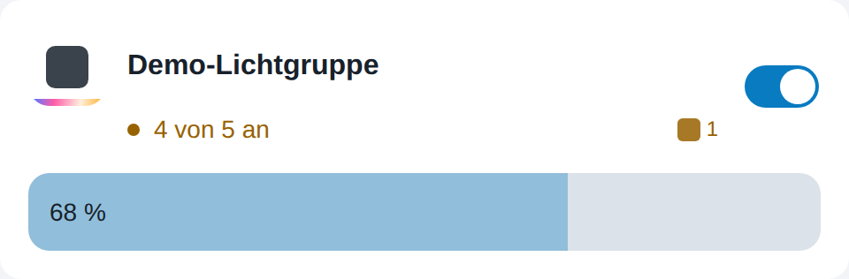
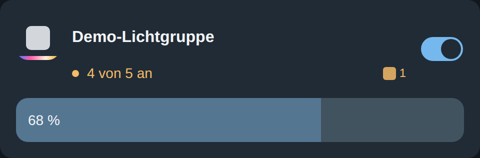

# Busch Light Cards

A Hue-like light and scene card for Home Assistant: one card,
**`busch-light-card`**. Its looks follow
[lovelace-hue-like-light-card][upstream] by Gh61, but it handles groups and
unavailable entities differently.




## What the card does

- **Resolves nested groups on every level.** Home Assistant light groups,
  old-style `group.*` entities, Zigbee2MQTT groups (`group_entities`) and
  Magic Areas groups (`lights`) are walked down to the real lights. A light
  that sits in several groups is shown and switched once; cycles are cut;
  `max_depth` bounds the walk. Only `light.*` and `switch.*` members are kept.
- **Survives unavailable entities.** Counters, brightness and colour come from
  the reachable members only, service calls go only to reachable members, and a
  deleted member renders as unavailable instead of throwing. When a group goes
  unavailable (Home Assistant then drops its member list) the card keeps using
  the last member list it saw. If every member is unreachable, the card is
  disabled and says so.
- **Card:** a tile in the light's own colour, an on/off switch, a brightness
  slider and a badge counting unreachable members.
- **Dialog** (opens on tap by default): scene tiles, group brightness, a colour
  wheel and a colour-temperature bar (limited to the range all lights support),
  and one tile per light with its own switch. Resolved groups keep their own
  block with their own counter and switch. A master switch sits in the header.
  Escape and the browser's back gesture close the dialog (from a light's detail
  view they first return to the group).
- **Visual editor** with a live preview of the resolution, one-click import of
  every scene that uses the card's lights, and German and English texts
  (following the Home Assistant language).

## Requirements

- Home Assistant **2026.9.3** or newer. Earlier versions are untested.
- Light, switch or group entities. Scenes and scripts are optional.

## Installation

### HACS

1. HACS, three-dot menu, **Custom repositories**.
2. Add `https://github.com/luukkii123/ha-busch-lightcards` with category
   **Dashboard**.
3. Install **Busch Light Cards** and hard-refresh the browser
   (`Ctrl+Shift+R`) so the old file is not served from cache.

### Manual

1. Copy `dist/busch-lightcards.js` to `/config/www/`.
2. Under **Settings, Dashboards, Resources** (three-dot menu) add
   `/local/busch-lightcards.js` as a **JavaScript module**.

## Configuration

Add the card from the card picker and use the visual editor, or write YAML.
Minimal example:

```yaml
type: custom:busch-light-card
entity: light.living_room_all
```

With scenes:

```yaml
type: custom:busch-light-card
entity: light.living_room_all
title: Living room
scenes:
  - entity: scene.daylight
    color: "#ffe0a3"
  - entity: scene.night
    title: Night
    icon: mdi:weather-night
  - scene.autumn
```

### Options

At least one of `entity` or `entities` is required. Every option may also be
written in camelCase (`resolveGroups`, `offColor`, ...), which keeps a config
copied from the upstream card working; the editor folds it into snake_case.

| Key | Type | Default | Meaning |
| --- | --- | --- | --- |
| `entity` | string | - | The main light, switch or group. |
| `entities` | list of strings | - | Further entities, resolved and merged with `entity`. |
| `title` | string | name of the entity | Replaces the name on the card and in the dialog. |
| `icon` | string | icon of the entity, else `mdi:lightbulb-group` | mdi icon of the card. |
| `description` | string | count of lights on | Replaces the line under the title. |
| `resolve_groups` | boolean | `true` | Walk into nested groups. `false` keeps a group as a single entity (upstream behaviour). |
| `max_depth` | number (1-20 in the editor) | `10` | Maximum number of group levels to descend. |
| `show_unavailable` | boolean | `true` | Show the badge counting unreachable members. |
| `group_display` | `sections` / `flat` | `sections` | Dialog layout: one block per resolved group, or one flat list of tiles. |
| `off_color` | string | theme | Card background while everything is off. Empty uses the theme colour. |
| `default_color` | string | `#ffda95` | Colour for a lit light that reports none. Accepts `#rgb`, `#rrggbb`, `rgb(...)`, `rgba(...)`, `warm`, `cold` and basic colour names. |
| `hue_borders` | boolean | `true` | Stronger rounded corners and the Hue drop shadow. |
| `show_switch` | boolean | `true` | Show the group switch on the card. |
| `slider` | boolean | `true` | Show the brightness slider on the card. |
| `allow_zero` | boolean | `false` | Let the slider reach 0, which turns the group off (otherwise it stops at 1 %). |
| `off_shadow` | boolean | `true` | Inset shadow while everything is off. |
| `tap_action` | `dialog` / `toggle` / `more-info` / `none` | `dialog` | Short tap on the card. |
| `hold_action` | `dialog` / `toggle` / `more-info` / `none` | `more-info` | Holding the card for half a second. |
| `scenes` | list | `[]` | Scene tiles at the top of the dialog; see below. |

`scenes` entries are either an entity id (scene or script) or an object:

| Key | Type | Default | Meaning |
| --- | --- | --- | --- |
| `entity` | string | - (required) | The scene or script the tile triggers. |
| `title` | string | name of the entity | Text on the tile. |
| `icon` | string | icon of the entity, else `mdi:palette` | Icon on the tile. |
| `color` | string or `[r, g, b]` | `#ffda95` | Colour of the round badge on the tile. |

The visual editor writes only options that differ from their default.

### Sections layout

The card takes 12 grid columns (minimum 6) and leaves the height to Home
Assistant, which measures the content.

### Theme variables

The card reads these CSS variables with built-in fallbacks. They are declared
on the card element itself, so set them on `busch-light-card` (for example with
card-mod), not only on `:root`.

| Variable | Used for |
| --- | --- |
| `--blc-background`, `--blc-text-color`, `--blc-shadow` | Card background, text and shadow |
| `--blc-toggle-off`, `--blc-toggle-on`, `--blc-knob-color` | Switch track and knob |
| `--blc-accent` | Accent of the card (default `--primary-color`) |
| `--blc-dialog-bg`, `--blc-dialog-text`, `--blc-dialog-invert`, `--blc-dialog-tile`, `--blc-dialog-muted`, `--blc-dialog-dim`, `--blc-dialog-faint`, `--blc-dialog-line`, `--blc-dialog-dead-a`, `--blc-dialog-dead-b`, `--blc-scene-badge` | Dialog surface, text, tiles, lines, hatching of unreachable lights and the scene badge. The dialog is dark in both Home Assistant themes by default. |

## Development

Notes on the test setup are in [docs/entwicklung.md](docs/entwicklung.md).

## License

MIT, see [LICENSE](LICENSE). Not affiliated with, or endorsed by,
Signify/Philips Hue.

[upstream]: https://github.com/Gh61/lovelace-hue-like-light-card
